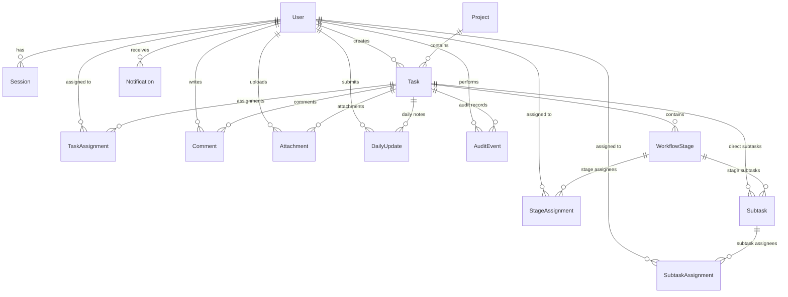

# Data Model & Schema Specification: Private Team Workspace

## 1. Relational Entity-Relationship Model



---

## 2. Detailed Prisma Schema Specification

```prisma
datasource db {
  provider = "postgresql"
  url      = env("DATABASE_URL")
}

generator client {
  provider = "prisma-client-js"
}

enum Role {
  ADMIN
  USER
}

enum Department {
  DEVELOPMENT
  CONTENT
}

enum TaskType {
  FEATURE
  BUG
  HOTFIX
}

enum Priority {
  LOW
  MEDIUM
  HIGH
  CRITICAL
}

enum TaskStatus {
  BACKLOG
  PLANNED
  IN_PROGRESS
  PAUSED
  BLOCKED
  DONE
  CANCELLED
}

enum SubtaskStatus {
  TODO
  IN_PROGRESS
  DONE
  CANCELLED
}

enum AuditAction {
  TASK_CREATED
  TASK_UPDATED
  TASK_ASSIGNED
  TASK_UNASSIGNED
  STAGE_CREATED
  STAGE_REORDERED
  STAGE_COMPLETED
  STAGE_DELETED
  SUBTASK_CREATED
  SUBTASK_COMPLETED
  SUBTASK_REOPENED
  SUBTASK_DELETED
  STATUS_CHANGED
  WORK_PAUSED
  WORK_RESUMED
  DEADLINE_CHANGED
  SCHEDULE_CHANGED
  PRIORITY_CHANGED
  ATTACHMENT_ADDED
  ATTACHMENT_REMOVED
  ATTACHMENT_DELETED
  COMMENT_ADDED
  COMMENT_DELETED
  DAILY_UPDATE_ADDED
  USER_CREATED
  USER_STATUS_CHANGED
  CALENDAR_UPDATED
  DEPARTMENT_CHANGED
}

model User {
  id           String     @id @default(uuid())
  email        String     @unique
  name         String
  role         Role       @default(USER)
  department   Department @default(DEVELOPMENT)
  passwordHash String
  avatarUrl    String?
  isActive     Boolean    @default(true)
  createdAt    DateTime   @default(now())
  updatedAt    DateTime   @updatedAt

  sessions            Session[]
  createdTasks        Task[]                @relation("TaskCreator")
  taskAssignments     TaskAssignment[]
  stageAssignments    StageAssignment[]
  subtaskAssignments  SubtaskAssignment[]
  completedSubtasks   Subtask[]             @relation("SubtaskCompleter")
  comments            Comment[]
  attachments         Attachment[]
  dailyUpdates        DailyUpdate[]
  auditEvents         AuditEvent[]          @relation("AuditActor")
  notifications       Notification[]

  @@map("users")
}

model Session {
  id        String   @id @default(uuid())
  userId    String
  token     String   @unique
  expiresAt DateTime
  createdAt DateTime @default(now())

  user User @relation(fields: [userId], references: [id], onDelete: Cascade)

  @@index([token])
  @@map("sessions")
}

model Project {
  id          String   @id @default(uuid())
  name        String
  description String?
  color       String?  @default("#EA580C")
  isArchived  Boolean  @default(false)
  createdAt   DateTime @default(now())
  updatedAt   DateTime @updatedAt

  tasks Task[]

  @@map("projects")
}

model Task {
  id              String      @id @default(uuid())
  taskNumber      Int         @unique @default(autoincrement()) // e.g. TASK-104
  projectId       String
  title           String
  description     String?
  type            TaskType    @default(FEATURE)
  priority        Priority    @default(MEDIUM)
  status          TaskStatus  @default(BACKLOG)
  department      Department  @default(DEVELOPMENT)
  
  // Date & Scheduling
  startDate       DateTime?
  deadline        DateTime?
  deadlineLocked  Boolean     @default(false) // Becomes true upon first assignment/deadline save
  
  // Progress & Execution
  progress        Int         @default(0) // Centralized calculation: 0 - 100%
  pausedAt        DateTime?
  pauseReason     String?
  blockedReason   String?
  completedAt     DateTime?
  
  createdById     String
  createdAt       DateTime    @default(now())
  updatedAt       DateTime    @updatedAt

  project         Project              @relation(fields: [projectId], references: [id], onDelete: Cascade)
  creator         User                 @relation("TaskCreator", fields: [createdById], references: [id])
  stages          WorkflowStage[]
  subtasks        Subtask[]
  assignments     TaskAssignment[]
  comments        Comment[]
  attachments     Attachment[]
  dailyUpdates    DailyUpdate[]
  auditEvents     AuditEvent[]
  notifications   Notification[]

  @@index([projectId])
  @@index([status])
  @@index([startDate, deadline])
  @@map("tasks")
}

model WorkflowStage {
  id          String    @id @default(uuid())
  taskId      String
  position    Int       @default(0)
  title       String    // e.g. დიზაინი, Development, QA
  description String?
  isActive    Boolean   @default(false) // The currently active sequential stage
  isCompleted Boolean   @default(false)
  completedAt DateTime?

  task        Task              @relation(fields: [taskId], references: [id], onDelete: Cascade)
  assignments StageAssignment[]
  subtasks    Subtask[]

  @@index([taskId, position])
  @@map("workflow_stages")
}

model StageAssignment {
  id        String   @id @default(uuid())
  stageId   String
  userId    String
  createdAt DateTime @default(now())

  stage WorkflowStage @relation(fields: [stageId], references: [id], onDelete: Cascade)
  user  User          @relation(fields: [userId], references: [id], onDelete: Cascade)

  @@unique([stageId, userId])
  @@map("stage_assignments")
}

model Subtask {
  id          String        @id @default(uuid())
  taskId      String
  stageId     String?
  position    Int           @default(0)
  title       String
  description String?
  status      SubtaskStatus @default(TODO)
  
  startDate   DateTime?
  deadline    DateTime?

  completedById String?
  completedAt   DateTime?
  createdAt     DateTime      @default(now())
  updatedAt     DateTime      @updatedAt

  task        Task                @relation(fields: [taskId], references: [id], onDelete: Cascade)
  stage       WorkflowStage?      @relation(fields: [stageId], references: [id], onDelete: SetNull)
  completedBy User?               @relation("SubtaskCompleter", fields: [completedById], references: [id])
  assignments SubtaskAssignment[]

  @@index([taskId])
  @@index([stageId])
  @@map("subtasks")
}

model TaskAssignment {
  id        String   @id @default(uuid())
  taskId    String
  userId    String
  createdAt DateTime @default(now())

  task Task @relation(fields: [taskId], references: [id], onDelete: Cascade)
  user User @relation(fields: [userId], references: [id], onDelete: Cascade)

  @@unique([taskId, userId])
  @@map("task_assignments")
}

model SubtaskAssignment {
  id        String   @id @default(uuid())
  subtaskId String
  userId    String
  createdAt DateTime @default(now())

  subtask Subtask @relation(fields: [subtaskId], references: [id], onDelete: Cascade)
  user    User    @relation(fields: [userId], references: [id], onDelete: Cascade)

  @@unique([subtaskId, userId])
  @@map("subtask_assignments")
}

model Comment {
  id        String   @id @default(uuid())
  taskId    String
  userId    String
  content   String
  createdAt DateTime @default(now())
  updatedAt DateTime @updatedAt

  task Task @relation(fields: [taskId], references: [id], onDelete: Cascade)
  user User @relation(fields: [userId], references: [id], onDelete: Cascade)

  @@map("comments")
}

model Attachment {
  id           String   @id @default(uuid())
  taskId       String
  userId       String
  originalName String
  storedName   String
  mimeType     String
  sizeBytes    Int
  url          String?  // For external links like GitLab/Figma
  isExternal   Boolean  @default(false)
  createdAt    DateTime @default(now())

  task Task @relation(fields: [taskId], references: [id], onDelete: Cascade)
  user User @relation(fields: [userId], references: [id], onDelete: Cascade)

  @@map("attachments")
}

model DailyUpdate {
  id        String   @id @default(uuid())
  taskId    String
  userId    String
  content   String   // "რა გააკეთე დღეს?"
  createdAt DateTime @default(now())

  task Task @relation(fields: [taskId], references: [id], onDelete: Cascade)
  user User @relation(fields: [userId], references: [id], onDelete: Cascade)

  @@map("daily_updates")
}

model AuditEvent {
  id         String      @id @default(uuid())
  taskId     String?
  actorId    String
  action     AuditAction
  entityType String      // "TASK", "SUBTASK", "STAGE", "DEADLINE", etc.
  entityId   String
  oldValues  Json?
  newValues  Json?
  reason     String?
  createdAt  DateTime    @default(now())

  task  Task? @relation(fields: [taskId], references: [id], onDelete: Cascade)
  actor User  @relation("AuditActor", fields: [actorId], references: [id])

  @@index([taskId])
  @@index([createdAt])
  @@map("audit_events")
}

model Notification {
  id        String   @id @default(uuid())
  userId    String
  taskId    String?
  title     String
  message   String
  isRead    Boolean  @default(false)
  createdAt DateTime @default(now())

  user User  @relation(fields: [userId], references: [id], onDelete: Cascade)
  task Task? @relation(fields: [taskId], references: [id], onDelete: Cascade)

  @@index([userId, isRead])
  @@map("notifications")
}

model WorkingCalendar {
  id          String   @id @default(uuid())
  dayOfWeek   Int      // 0 = Sunday, 1 = Monday, ..., 6 = Saturday
  isWorking   Boolean  @default(true) // Mon-Fri = true, Sat-Sun = false
  createdAt   DateTime @default(now())
  updatedAt   DateTime @updatedAt

  @@unique([dayOfWeek])
  @@map("working_calendars")
}

model Holiday {
  id        String   @id @default(uuid())
  date      DateTime @unique
  name      String   // Georgian name: e.g. "ახალი წელი", "გიორგობა"
  isOfficial Boolean  @default(true)
  createdAt DateTime @default(now())

  @@map("holidays")
}
```

---

## 3. Critical Invariants Enforced by Backend

1. **Deterministic Stage Order**: Stages are strictly ordered by `position ASC`. Only one stage can be `isActive = true` at any given time.
2. **Progress Calculation Denominator**: `Progress = (COUNT(completed subtasks) / COUNT(active subtasks)) * 100`. Subtasks with multiple assignees are counted once. Cancelled subtasks are excluded from the denominator.
3. **Deadline Immobility (Backend Gate)**:
   ```typescript
   if (existingTask.deadlineLocked && !isAdmin && hasDeadlineChanged(existingTask.deadline, incomingDeadline)) {
     throw new AuthorizationError("დედლაინის შეცვლა შეუძლია მხოლოდ ადმინისტრატორს.");
   }
   ```
4. **Append-Only Audit**: Every mutation writes to `AuditEvent` inside the same database transaction.
